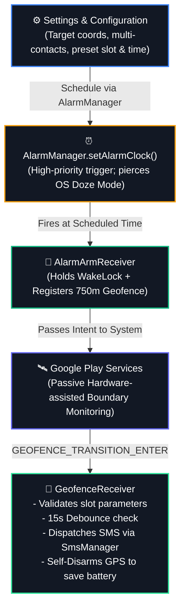

# Reached 📍

### Autonomous, Battery-Efficient Geofencing & SMS Dispatcher for Android

  <b>Eliminate repetitive "I've reached safely" texts.</b> 
  Reached runs silently in the background, arms itself at your schedule, tracks your arrival via hardware geofencing, dispatches confirmation texts, and disarms itself to preserve 100% of your day's battery.

[📦 Download APK](https://github.com/Rudra1725/Reached_App/releases/latest) • [🌐 Live Demo / Landing Page](https://appetize.io/app/b_vo7kgko3o3eizyl2t6gvloclai) • [Report Bug](https://github.com/Rudra1725/Reached_App/issues)

---

## 📌 The Problem

Commuters, students, and daily travelers often need to notify family or guardians the moment they reach their destination (e.g., college, school, workplace). 

* **Manual texting is forgetful:** Forgetting to text leads to unnecessary panic or missed notifications.
* **Continuous GPS trackers drain battery:** Traditional continuous-location tracker apps drain 15–30% of battery per commute by running continuous foreground location loops.

**Reached 📍 solves this completely:** It requires **zero** foreground GPS tracking during the day. It schedules an exact low-power alarm clock trigger, activates an OS-level circular geofence perimeter, automatically dispatches arrival SMS messages across multiple recipients via Android's native `SmsManager`, and self-terminates immediately upon trigger.

---

## ✨ Features

- 🔋 **Zero Continuous GPS Drain:** Leverages Google Play Services Hardware Geofencing rather than continuous location tracking loops.
- ⏰ **Deep-Doze Bypass (`AlarmManager.setAlarmClock`):** Pierces aggressive OEM battery killers (MIUI/HyperOS, Realme UI, ColorOS) using prioritized alarm-clock intents.
- 🗂️ **Multi-Slot Preset Architecture:** Store up to 3 isolated presets (e.g., *College Campus*, *Workplace*, *Home Base*), each with independent coordinates, daily schedules, custom message templates, and dedicated contact lists.
- 👥 **Multi-Contact SMS Routing:** Automatically splits and delivers customized SMS updates to multiple recipients per preset without third-party gateways.
- 🛡️ **Debounce & Self-Disarm Guard:** Built-in 15-second debounce cooldown prevents duplicate SMS firing, followed by an immediate auto-disarm to shut down background radios.
- 🎨 **Obsidian Dark UI:** Sleek glassmorphism aesthetic built with Material Components, smooth animations, live status badges, and direct developer links.

---

## 🏗️ Architecture & How It Works

